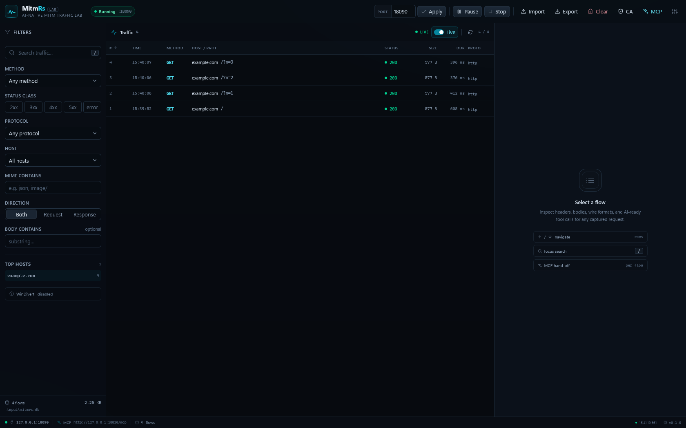

# MitmRs

面向 Windows 的 AI 原生 HTTPS 中间人流量分析工具。它把 mitmweb 风格的 Web 抓包分析界面、可配置的 MITM 代理、gRPC/Protobuf 无 schema 解码、导入导出，以及 **MCP（Model Context Protocol）工具集** 放在同一个 Rust 可执行文件里。



前端使用 Vite + Vue 3 + TypeScript + Tailwind CSS 构建，编译时通过 `rust-embed` 嵌入可执行文件，运行时不需要额外的静态资源目录。

```
┌────────────────────┐       ┌──────────────────────────────────────────┐
│ Browser / AI agent │       │                mitmrs.exe                │
│                    │ HTTP  │                                          │
│  Web UI  ──────────┼──────►│  Axum: /api/*  /mcp  embedded Vue assets │
│  MCP client ───────┼──────►│                                          │
└────────────────────┘       │  Proxy engine                            │
                             │   ├─ HTTP/1.1 explicit proxy + CONNECT   │
                             │   ├─ TLS MITM (local CA, per-host cert)  │
                             │   ├─ HTTP/2 / gRPC / gRPC-Web            │
                             │   ├─ streaming response capture          │
                             │   └─ WinDivert transparent redirect      │
                             │                                          │
                             │  SQLite store + decoders + SSE events    │
                             └──────────────────────────────────────────┘
```

## 功能

- **真正的 HTTPS MITM**：本地 CA + 按 SNI/域名动态签发证书，支持 HTTP/1.1、HTTP/2、gRPC（含 trailers）和 gRPC-Web。
- **两种接入方式**
  - 显式代理：默认 `127.0.0.1:8080`，浏览器、curl、Python/Node SDK 直接设置 HTTP/HTTPS 代理。
  - WinDivert 透明重定向（可选，需管理员）：把本机出站 TCP `:80/:443` 重定向到本地代理，客户端无需配置代理。
- **Web 分析界面**：流量列表、搜索/过滤、请求/响应/Headers/Trailers、JSON 美化、hex/raw、cURL 生成、SSE 实时刷新、解码树、MCP 示例；支持每页 100/200/500 条翻页、单条删除与一键清空（带确认）。
- **AI 优先的 MCP 服务**：Streamable HTTP JSON-RPC 2.0 端点 `/mcp`，另有 `mcp-stdio` 桥接模式。AI 可以列出最近流量、分页搜索全部结果、过滤、读取上下行 body、切换解码格式、导出/导入、启停代理。
- **内置解码器**：auto、HTTP 消息、HTTP/2、gRPC/gRPC-Web、Protobuf（无 `.proto`）、JSON、XML/HTML、表单、multipart、SSE、WebSocket 帧、TLS records/SNI、文本（含 GBK 等字符集）、base64、hex、gzip/deflate/brotli/zstd、raw。
- **生命周期控制**：启动、停止、暂停、恢复、重启、运行时修改代理端口（自动重启监听）、开启/关闭抓包、MCP 同步控制。
- **链式代理（选配）**：可以把 MitmRs 的上游流量再交给一个 HTTP 代理（如本机 `127.0.0.1:7890`），在设置里勾选并填写地址即可；地址会持久化，下次启动继续使用。
- **持久化与交换**：SQLite（WAL）保存全部流量；原生 JSON 全量导出/导入（body base64 保真）；HAR 1.2 导出和 HAR 导入。
- **单文件分发**：Web 资源嵌入 exe；WinDivert DLL/SYS 由构建脚本放到 exe 同目录。

> HTTP 版本处理：普通 Web 流量即使客户端使用 HTTP/2，上游也优先使用 HTTP/1.1 转发，避免只支持 h1 的网关/源站返回 400 或 502；原生 gRPC 才使用端到端 HTTP/2。因此列表中的 `http_version` 表示客户端到 MitmRs 的协议，不一定等于 MitmRs 到源站的协议。

## 快速开始

### 环境

- Windows 10/11 x64
- Rust 1.88+（MSVC toolchain）
- Node.js 20+ / pnpm 9+
- `third_part/WinDivert-2.2.2-A/x64`（仓库已带）

### 构建

```powershell
# 1. 构建前端（输出 web/dist）
pnpm --dir web install
pnpm --dir web build

# 2. 构建 Rust（debug）
cargo build

# 或一条命令构建 release 发行目录 dist/
powershell -ExecutionPolicy Bypass -File scripts/build.ps1
```

`cargo build` 需要 `web/dist` 已存在，因为资源在编译期嵌入。`scripts/build.ps1` 会自动处理前端、release 构建和 WinDivert 运行时文件复制。

### 运行

```powershell
.\target\debug\mitmrs.exe
# 或
.\dist\mitmrs.exe
```

默认地址：

| 项目 | 默认值 |
|---|---|
| Web UI / API | `http://127.0.0.1:8787/` |
| MCP | `http://127.0.0.1:8787/mcp` |
| 代理 | `http://127.0.0.1:8080` |
| 数据目录 | `%LOCALAPPDATA%\MitmRs` |
| CA | `%LOCALAPPDATA%\MitmRs\ca\ca.crt` |
| SQLite | `%LOCALAPPDATA%\MitmRs\mitmrs.db` |

常用参数：

```powershell
mitmrs.exe --proxy-port 8888 --web-port 9000
mitmrs.exe --data-dir D:\mitmrs-data --no-open
mitmrs.exe --insecure-upstream          # 不校验上游 TLS（仅测试自签名服务）
mitmrs.exe --windivert                  # 管理员权限 + WinDivert 透明模式
mitmrs.exe mcp-stdio --url http://127.0.0.1:8787/mcp
```

### 信任 CA（HTTPS 必需）

1. 打开 Web UI → 顶部 **CA** → 下载 `mitmrs-ca.crt`。
2. 以管理员身份执行：

```powershell
certutil -addstore -f Root "$env:LOCALAPPDATA\MitmRs\ca\ca.crt"
```

3. 重启浏览器。Firefox 使用自己的证书库，需在“设置 → 隐私与安全 → 证书 → 查看证书 → 证书颁发机构 → 导入”中单独导入。
4. curl 测试：

```powershell
curl.exe --ssl-no-revoke --cacert "$env:LOCALAPPDATA\MitmRs\ca\ca.crt" `
  -x http://127.0.0.1:8080 https://example.com/
```

> `--ssl-no-revoke` 只是因为 Windows Schannel 对本地 CA 的吊销状态未知；生产环境应按企业证书策略处理。

首次运行生成的根 CA **有效期为 10 年（3650 天）**，`not_before` 回拨 1 天以容忍时钟偏差；到期时间在 CA 弹窗和 `/api/status` 的 `ca.not_after` 中可见。删除 `%LOCALAPPDATA%\MitmRs\ca` 后重启会生成新的 10 年 CA（客户端需要重新信任）。

### 配置客户端代理

- Windows：设置 → 网络和 Internet → 代理 → 手动设置代理 → `127.0.0.1:8080`。
- 浏览器插件（SwitchyOmega 等）：HTTP 和 HTTPS 都指向 `127.0.0.1:8080`。
- Python requests：`proxies={"http": "http://127.0.0.1:8080", "https": "http://127.0.0.1:8080"}`。
- Node：`HTTPS_PROXY=http://127.0.0.1:8080`。
- 不需要代理的地址请加入 `NO_PROXY`（如内网、更新服务）。

### 链式代理（下一跳，选配）

默认情况下 MitmRs 直接连接源站。如果本机需要先经过另一个 HTTP 代理（例如 Clash、公司代理）才能访问目标站点：

1. 打开 Web UI → 顶部 **Settings**。
2. 勾选 **Chain proxy (next hop)**，填写下一跳地址，例如 `127.0.0.1:7890` 或 `http://127.0.0.1:7890`。
3. 保存后立即生效，新建立的上游连接会走该代理，无需重启代理或程序。

说明：

- 只有 HTTP 代理（`http://host:port`）受支持；`host:port` 会自动按 `http://` 解析。URL 中带用户名密码时会以 Basic 认证发送 `Proxy-Authorization`。
- HTTP 请求以 absolute-form 转发给下一跳；HTTPS 通过 `CONNECT` 隧道后由 MitmRs 与源站完成 TLS 握手，因此抓包解码、证书伪造等行为不变。
- 取消勾选后不再走下一跳，但地址仍会保存在 `config.json` 中，下次打开界面会自动回填。
- 地址不能指向 MitmRs 自己的监听端口（会形成环）；禁用的非法地址只会被记住，不会影响启动。
- 也可以让 AI 通过 MCP 设置：`proxy_control {action:"set_config", upstream_proxy_enabled:true, upstream_proxy_url:"127.0.0.1:7890"}`。

示例：浏览器已经指向 MitmRs（`127.0.0.1:8080`），而访问 `google.com` 必须经过本机 `127.0.0.1:7890`，只需要在设置里启用并填写 `127.0.0.1:7890`。

## WinDivert 透明模式

需要 **管理员权限**，并且 `WinDivert.dll`、`WinDivert64.sys` 与 exe 同目录（`scripts/build.ps1` 会自动复制）。

启动方式：

```powershell
# 启动时开启
.\dist\mitmrs.exe --windivert

# 或运行中通过 API / UI 开启
curl -X POST http://127.0.0.1:8787/api/windivert/start
```

工作原理：

1. WinDivert 在 NETWORK 层捕获本机出站 IPv4 TCP `:80/:443` 的 SYN。
2. 为每条连接分配一个本地 relay 源端口（20000–29999），把包的源/目的改写到 `127.0.0.1:<relay>` → `127.0.0.1:<proxy>`，重算校验和并重新注入。
3. 代理监听器通过 accept 的对端端口查表，恢复原始目的地址；TLS 用 SNI 签证书。
4. 代理回包从 `127.0.0.1:<proxy>` 发出，WinDivert 捕获后把源改回原始服务器 IP:端口、目的改回客户端，重新注入，客户端完全无感。
5. 代理自身访问上游的 socket 被绑定到保留源端口段 30000–39999，过滤器排除该段，避免流量再次被重定向形成环。

限制与注意事项：

- 只处理 IPv4 + TCP 的 80/443；IPv6、QUIC/HTTP3、UDP 不处理。
- 会接管全机器这些端口的直连流量；与 VPN、其他 WinDivert 工具、网络加速器可能冲突。
- 开启前请先确认代理已在运行；停止代理会自动停止 WinDivert。
- 非管理员会返回明确错误。驱动被安全软件拦截时也会报错。
- 本机 `127.0.0.1` / 回环流量不劫持。
- 由于 30000–39999 被排除，极少数应用若恰好使用该源端口段会绕过透明抓取（不影响显式代理）。

## MCP：给 AI 的抓包分析接口

MitmRs 的 MCP 服务使用 **Streamable HTTP**（JSON-RPC 2.0），无状态、无需 SSE 会话即可调用工具。

### 接入 Claude Code

```powershell
claude mcp add --transport http mitmrs http://127.0.0.1:8787/mcp
```

### 接入 Cursor / 其他支持 HTTP MCP 的客户端

```json
{
  "mcpServers": {
    "mitmrs": {
      "url": "http://127.0.0.1:8787/mcp"
    }
  }
}
```

### stdio 桥接（只支持 stdio 的客户端）

```json
{
  "mcpServers": {
    "mitmrs": {
      "command": "F:\\path\\to\\mitmrs.exe",
      "args": ["mcp-stdio", "--url", "http://127.0.0.1:8787/mcp"]
    }
  }
}
```

### 直接测试

```powershell
curl http://127.0.0.1:8787/mcp `
  -H "content-type: application/json" `
  -d '{"jsonrpc":"2.0","id":1,"method":"tools/list"}'
```

### 工具列表

| 工具 | 用途 |
|---|---|
| `traffic_search` | 按 host/method/status/protocol/mime/body 子串/时间/错误/tag 搜索，返回摘要和分页 |
| `traffic_recent` | 按时间倒序列出最近 N 条（默认 50，单页最多 500），可用 `offset` / `next_offset` 继续翻页 |
| `traffic_get` | 取单条流量的请求/响应头、trailers、body、元数据；可选自动解码 |
| `traffic_body` | 只取一个方向，支持 auto/text/base64/hex 及全部解码格式 |
| `traffic_decode` | 用指定格式解码上下行 body，返回 `text` + 结构化 `tree` + `meta` |
| `decoders_list` | 列出解码器、content-type 和选项 |
| `traffic_stats` | 总量、Top hosts、状态码分布、字节数、时间范围 |
| `traffic_export` | 按筛选条件导出原生 JSON 或 HAR（返回字符串） |
| `traffic_import` | 导入原生 JSON / 数组 / HAR |
| `traffic_clear` | 清空流量（需 `confirm=true`） |
| `traffic_delete` | 删除单条流量 |
| `proxy_control` | status/start/stop/pause/resume/restart/set_config，可改端口、抓包开关、body 上限 |
| `ca_certificate` | 返回 CA PEM、SHA-256 指纹、Windows 安装命令 |
| `mitmrs_help` | 工作流说明 |

> MCP 不返回无上限的单次结果：`traffic_recent` / `traffic_search` 每页最多 500 条，响应中的 `total` 和 `next_offset` 用于分页遍历全部抓包结果。这样既能让 AI 拿到“最近多少条”，也避免一次响应撑爆上下文。

推荐 AI 工作流：

1. `ca_certificate` → 确认/安装 CA。
2. `proxy_control {action:"status"}` → 确认代理运行。
3. `traffic_stats` → 了解 host/状态分布。
4. `traffic_search {host, status, q}` → 定位流量。
5. `traffic_get` 或 `traffic_decode {format:"grpc"}` → 深入分析。
6. `traffic_export` → 交接给其他工具。

## 内置解码器

| 格式 | 说明 |
|---|---|
| `auto` | 按 content-type / 内容特征自动选择；自动解 gzip/br/deflate/zstd |
| `http` | 重建 request/status line、headers、trailers、body |
| `http2` | 解密后的 HTTP/2 消息视图；`raw_frames=true` 时解析帧头 |
| `grpc` | 拆分 gRPC length-prefixed 帧，解消息压缩，解 Protobuf、trailers、gRPC-Web |
| `protobuf` | 无 schema wire 解码：field/wire/varint/string/nested/packed/hex |
| `json` / `xml` / `form` / `multipart` / `sse` | 常见文本协议 |
| `websocket` | 解析 FIN/opcode/mask/payload，支持文本和 hex |
| `tls` | 解析 TLS record、ClientHello SNI |
| `text` | 按 charset/BOM/UTF-8 lossy 解码（GBK、Shift_JIS 等） |
| `base64` / `hex` / `raw` | 原始字节的多种表示 |
| `gzip` | 显式解压并自动识别内层内容 |

所有解码 API 都接受 `options`，例如：

```json
{"direction":"response","format":"grpc","options":{"grpc_encoding":"gzip","max_bytes":2000000}}
```

## REST API

| 方法 | 路径 | 说明 |
|---|---|---|
| GET | `/api/status` | 代理、存储、CA、MCP、配置状态 |
| GET | `/api/flows` | 搜索/分页，参数同 `traffic_search` |
| GET | `/api/flows/{id}` | 单条详情；`?body=text\|base64\|both\|none` |
| GET | `/api/flows/{id}/body` | 原始 body |
| POST | `/api/flows/{id}/decode` | 切换解码格式 |
| DELETE | `/api/flows/{id}` | 删除单条 |
| DELETE | `/api/flows` | 清空 |
| GET | `/api/stats` | 聚合统计 |
| GET | `/api/decoders` | 解码器列表 |
| GET | `/api/events` | SSE：`flow` / `status` / `ping` |
| POST | `/api/proxy/start\|stop\|pause\|resume\|restart` | 生命周期 |
| POST | `/api/proxy/config` | `{port,max_body_bytes,capture_enabled,upstream_proxy_enabled,upstream_proxy_url}` |
| POST | `/api/windivert/start\|stop` | 透明模式 |
| GET | `/api/export?format=json\|har` | 导出下载 |
| POST | `/api/import` | 导入 JSON/HAR 文本 |
| GET | `/api/ca` / `/api/ca.crt` | CA 信息 / PEM |
| GET | `/api/mcp/info` | MCP 配置和工具清单 |

## 构建、测试、目录

```powershell
cargo fmt
cargo test
cargo clippy --all-targets -- -D warnings
powershell -ExecutionPolicy Bypass -File scripts/build.ps1
```

### GitHub Release

推送以 `v` 开头的 tag（例如 `v0.1.0`）会触发 `.github/workflows/release.yml`：

1. 在 `windows-latest` 构建前端并嵌入；
2. 运行 `cargo test --locked`；
3. `cargo build --release --locked`；
4. 打包 `MitmRs-v0.1.0-windows-x64.zip`，内含 exe、`WinDivert.dll`、`WinDivert64.sys`、README、许可证；
5. 生成 SHA-256 校验文件，上传 artifact 并自动发布到 GitHub Release。

```powershell
git tag v0.1.0
git push origin v0.1.0
```

```
src/
  main.rs             CLI / 启动 / 优雅退出
  api.rs              Axum REST + SSE + 静态资源
  mcp.rs              MCP JSON-RPC / 工具 / stdio 桥
  proxy/              代理生命周期、CONNECT/TLS、转发与流式捕获
  ca.rs               本地 CA 与按域名叶证书
  decode/             HTTP/gRPC/Protobuf/压缩/文本等解码器
  store.rs            SQLite 持久化、搜索、导出/导入
  windivert.rs        WinDivert 透明重定向与用户态 NAT
  upstream.rs         HTTP/1.1 + HTTP/2 上游客户端
web/                  Vue 3 前端源码与构建产物
third_part/           WinDivert 2.2.2-A
tests/                解码、存储、代理、MCP 集成测试
scripts/build.ps1     一键构建发行目录
.github/workflows/    tag 触发的 Windows release 工作流
docs/DESIGN.md        架构与设计取舍
docs/MCP.md           MCP 工具与 AI 工作流
```

## 已知限制

- 不解析 HTTP/3 / QUIC；WinDivert 模式仅 IPv4 TCP 80/443。
- WebSocket 升级不转发：HTTP Upgrade 请求会失败；CONNECT 内的非 TLS 流量可裸隧道但不做应用层捕获。
- 客户端证书（mTLS）、上游自定义 CA、SOCKS/HTTPS 上游代理未实现；链式代理仅支持 HTTP 下一跳（CONNECT 隧道可达 HTTPS 目标）。
- 请求体在转发前整体缓冲（上限 128 MB），超大上传会返回 502；响应体是流式转发 + 有上限捕获。
- SQLite 搜索是 `LIKE` 扫描，百万级流量建议先按 host/时间过滤或清理。

## 系统代理下出现 400/502？

0.1.0 的旧构建会把 HTTP/1.1 客户端流量统一用上游 HTTP/2 转发，部分 APISIX/网关会返回 400；只支持 h1 的源站会返回 502。当前版本已改为：

- 普通流量：下游 h1/h2 → 上游 **HTTP/1.1**
- 原生 gRPC：下游 h2 → 上游 **HTTP/2**
- 明文 gRPC：h2c prior knowledge

升级后请 **完全退出旧 MitmRs 实例，再启动新的 `dist\mitmrs.exe`**，并重启使用系统代理的应用/浏览器，让旧连接重新建立。历史列表中的 400/502 是修复前的记录，可用顶部 **Clear** 清空后再复测。
- 默认只监听 `127.0.0.1`。若改为 `0.0.0.0`，API/MCP 没有鉴权，请自行加防火墙或反向代理。

## 安全

MitmRs 会解密 HTTPS。请只在你有权分析的设备/流量上使用，并妥善保管 `%LOCALAPPDATA%\MitmRs\ca\ca.key`。私钥泄露意味着攻击者可以伪造被你信任的站点证书。卸载时请同时删除根证书：

```powershell
certutil -delstore Root "MitmRs Local CA"
```

## License

本项目代码使用 MIT License。WinDivert 按其 LGPLv3/GPLv2 双协议分发，详见 `third_part/WinDivert-2.2.2-A/LICENSE`。分发 `WinDivert.dll` / `WinDivert64.sys` 时请遵守其许可与签名要求。
